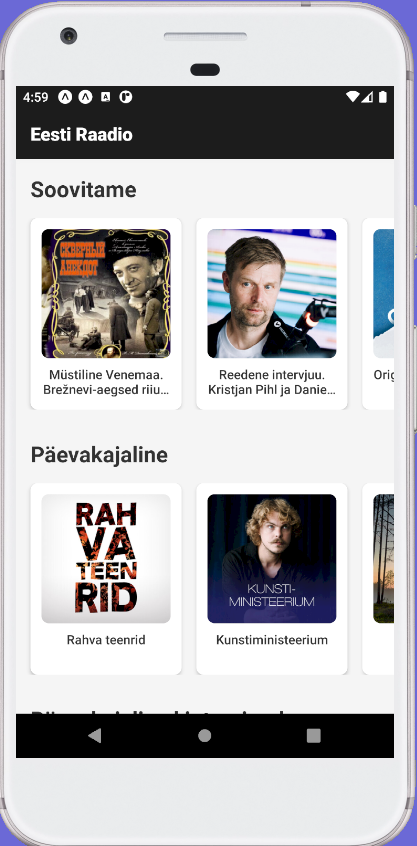
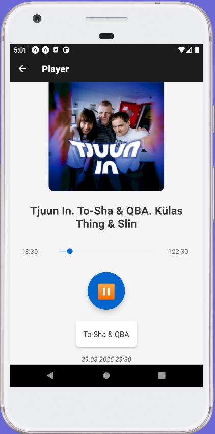
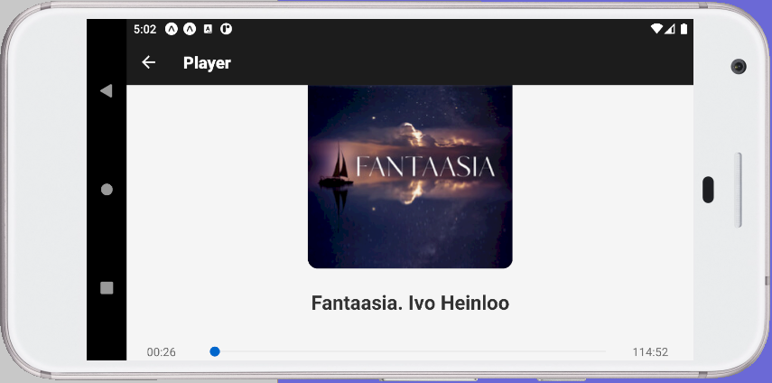

# 📻 Eesti Raadio

A mobile application for streaming Estonian radio stations, built with **React Native (Expo)**.  
The app supports audio playback and notifications.

---

## 🚀 Getting Started

### 1. Prerequisites
Make sure you have installed:
- [Node.js](https://nodejs.org/) (LTS version recommended)
- [Expo CLI](https://docs.expo.dev/get-started/installation/)
- Android Studio with an emulator
-- Target SDK version 34

Then install project dependencies:

```bash
npm install
```

### 2. Start Metro Bundler
```bash
npm start
```

Or run directly on an Android emulator:

```bash
npm run android
```

The application will automatically build and launch on the emulator.

---

## 🖼️ Demo

Screenshot of the app:  





---

## 📂 Project Structure

- `App.tsx` — entry point, navigation, and notification configuration  
- `src/screens/` — application screens (`HomeScreen`, `PlayerScreen`)  
- `src/contexts/` — contexts (e.g., `AudioProvider` for audio playback)  
- `assets/` — resources (images, icons, audio)  

---

## 📦 Key Dependencies

- **expo** ~49.0.0  
- **react-navigation** v6  
- **expo-av** — audio playback  
- **expo-notifications** — notifications  

---

## 🛠️ Troubleshooting

- If the emulator does not start, make sure the **Android Virtual Device (AVD)** is running in Android Studio.
- If Expo builder fails, clear cache with:  
  ```bash
  npx expo r -c
  ```  
- If Metro Bundler fails, clear cache with:  
  ```bash
  npx react-native start --reset-cache
  ```  
- For dependency issues, try removing `node_modules` and reinstalling:  
  ```bash
  rm -rf node_modules
  npm install
  ```

---

## 📝 License

All rights reserved.  
The author of this project does **not** permit redistribution, modification, or reuse of the source code without explicit permission. 
